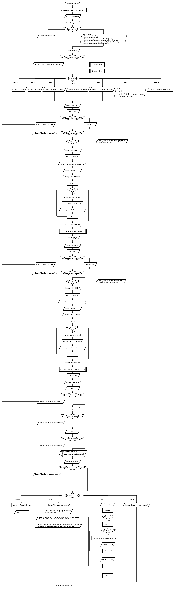
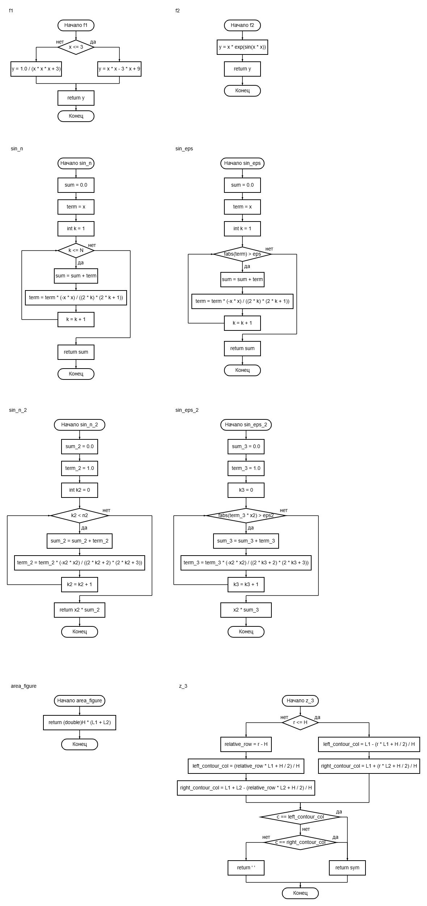
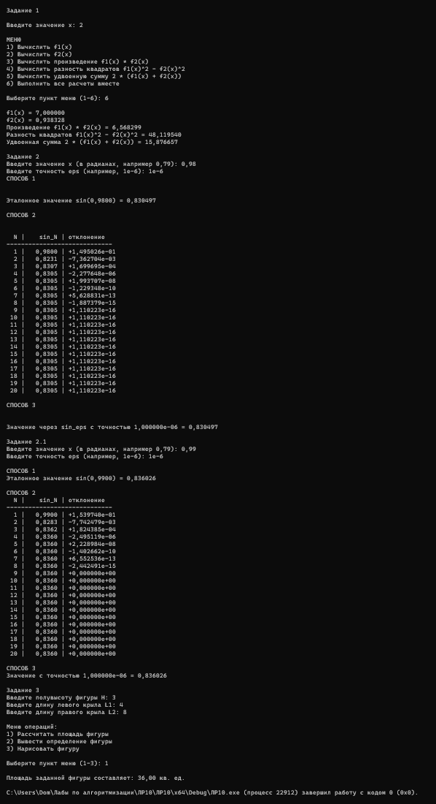

# Лабораторная работа 10

## Цель работы
Получение навыков разработки собственных функций

## Блок-схема

## Результаты работы программы

## Информация о разработчике
Орлова Эльвира Эдуардовна
Группа: бИД-261
